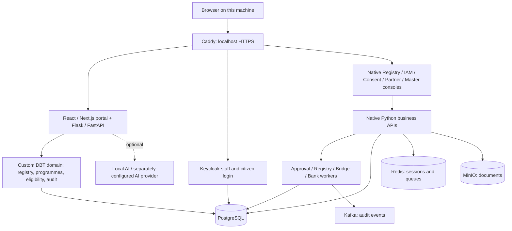
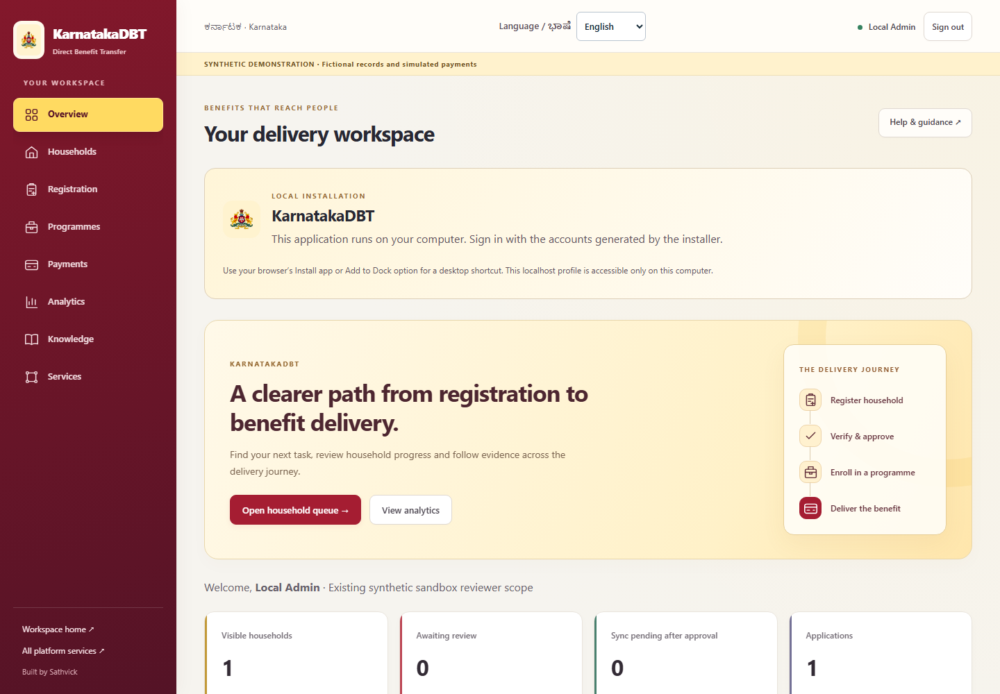

# KarnatakaDBT — AI in e-governance

**A customised Direct Benefit Transfer application framework for beneficiary registration, programme administration, eligibility, approvals and accountable benefit delivery.**

Built by the students of **Dr Sudheendra S G**, project head of **AI in e-governance**, with six participating students. The project is associated with the **GATCIIE innovation and incubation centre, Global Institute of Technologies**.

## Why this project matters

A benefit scheme succeeds when eligible people can apply, their information is checked consistently, and administrators can explain each decision. Fragmented spreadsheets and disconnected portals make duplicate records, delays and missing audit trails harder to resolve.

KarnatakaDBT brings the programme lifecycle into one application: household and individual registration, geographic information, configurable programme rules, independent review, eligibility checks, enrolment, payment simulations, grievances, dashboards and operational guidance. Kannada content helps staff and beneficiaries use the system in their own language.

The framework is **custom application code**, rather than an installation of a ready-made ERP. The local deployment does **not run OpenG2P, MOSIP, Odoo or ERPNext application services**. It uses established open-source infrastructure and libraries, including PostgreSQL, Redis, Keycloak, Kafka, MinIO, Python and React. Compatibility API paths, historical migration code and schema identifiers remain in the source; these are not evidence that an upstream business service is running. See [third-party notices](THIRD-PARTY-NOTICES.md) and [source provenance](SOURCE-PROVENANCE.json). “Custom-built” does not mean that every library or historical interface was invented by this project.

## Local installation

Cloning downloads source; it does not automatically execute software. After installing the prerequisites, run the launcher below. The installer builds the application, creates databases, generates new local secrets and users, and starts the services.

**No Cloudflare account, tunnel, public domain, Kubernetes cluster or production backup is needed.** Application ports bind to `127.0.0.1`, so this profile is accessible on this machine. Internet access is needed for the first dependency/image build. External map tiles and optional AI services may also need connectivity.

### Hardware and software

Allow **32 GB RAM recommended**, at least 16 GB available to Docker, a modern 64-bit CPU and **50 GB free disk space** for source, images, build cache and initial data. Larger datasets need more memory/storage. Optional local language models need additional resources. These are development sizing recommendations, not nationwide production capacity claims.

Install:

1. Git.
2. Python **3.10 or later** on the host; application Python, Node.js, Java and Caddy are supplied by containers.
3. Docker with **Linux containers**, plus the Docker Compose plugin (`docker compose`). Start Docker before running the launcher.
4. A current browser. Ports **8443–8469** must be free.

### Windows prerequisites and installation

Use a supported 64-bit Windows release meeting [Docker Desktop's current requirements](https://docs.docker.com/desktop/setup/install/windows-install/). Enable CPU virtualisation in BIOS/UEFI. Docker Desktop's WSL 2 backend requires Windows Subsystem for Linux and its virtual machine support.

In **Administrator PowerShell**, if WSL is not installed:

```powershell
wsl --install
wsl --update
```

Restart when Windows requests it. Install [Docker Desktop](https://docs.docker.com/desktop/setup/install/windows-install/), select its **WSL 2 backend** and **Linux containers**, and wait for the engine to start. Install [Git for Windows](https://git-scm.com/downloads/win) and [Python](https://www.python.org/downloads/windows/), enabling Python's launcher/PATH option. Open a new PowerShell window and verify:

```powershell
git --version
py -3 --version
docker version
docker compose version
```

Then, in a normal PowerShell window:

```powershell
git clone https://github.com/ssathvick/karnatakadbt.git
cd karnatakadbt
py -3 manage.py up
```

Alternatively, double-click **Start-Local.cmd** inside the cloned folder. If `py` is unavailable, use `python manage.py up`.

### macOS

Install Git, Python 3.10+ and [Docker Desktop for Mac](https://docs.docker.com/desktop/setup/install/mac-install/), choosing the correct Intel or Apple Silicon package. Start Docker and allocate adequate memory/disk resources. Then run in Terminal:

```bash
git clone https://github.com/ssathvick/karnatakadbt.git
cd karnatakadbt
python3 manage.py up
```

Container dependencies must support the host architecture. The release's validation report identifies the architecture actually tested; installation instructions do not imply that both Mac architectures were tested.

### Linux

Install Git, Python 3.10+, [Docker Engine](https://docs.docker.com/engine/install/) and the [Compose plugin](https://docs.docker.com/compose/install/linux/) using Docker's instructions for your distribution. Enable/start Docker and confirm your account can run `docker info`. Docker access grants substantial host privileges; follow the official account setup instructions.

```bash
git clone https://github.com/ssathvick/karnatakadbt.git
cd karnatakadbt
python3 manage.py up
```

You can also run `sh start-local.sh`. This profile uses Linux containers on every supported host; installing each backend library manually is unnecessary.

### First start, HTTPS and accounts

The initial build can take several minutes or longer depending on bandwidth and CPU. When startup succeeds, open:

**[KarnatakaDBT local portal](https://localhost:8443/registration/next/)**

The application uses secure cookies, so local HTTPS is retained. Each installation creates its own certificate authority. Trust this local certificate once, after the first start:

```bash
python manage.py trust
```

Use `py -3` on Windows or `python3` on Linux/macOS if appropriate. Windows imports the certificate into the current user's Root store; macOS uses the login keychain; Linux installs it into the system trust store using `sudo`. Firefox or other browsers with a separate certificate store may require importing `.local/caddy/pki/authorities/local/root.crt` manually. Trust only the certificate generated by your own installation.

Fresh, randomly generated passwords are in **`.local/credentials.json`** on your machine. Staff usernames are `admin`, `verifier` and `officer`; the synthetic beneficiary account is `citizen`. Identity administration uses `local-root`. **There are no shared default passwords.** Existing production credentials and beneficiary records are not included.

Keep the entire `.local` folder private: it contains credentials, encryption keys, local HTTPS material and application state. It is excluded from Git.

## Daily operation

```bash
python manage.py up       # build/start; retains existing local data
python manage.py check    # service health checks
python manage.py status   # container status
python manage.py logs     # follow application logs
python manage.py down     # stop; retain volumes and local state
```

Use the Python command appropriate to your platform. Re-running `up` preserves generated secrets and database state. Avoid deleting `.local` while retaining database volumes: the secrets and installation identity must match the databases.

For updates, back up first, run `git pull --ff-only`, then `python manage.py up`. Schema changes and large version upgrades require reviewing the release notes; this is not a promise of automatic compatibility with every future revision.

## Application areas

| Area | Purpose |
|---|---|
| Beneficiary and household intake | Capture application information, review status and programme applications |
| Programme management | Configure benefits, income thresholds, household size and versioned eligibility rules |
| Registry | Maintain individual/household definitions, layouts and records |
| Staff and IAM | Authenticate staff and manage application roles/permissions |
| Approvals and consent | Record decisions, responsibilities, consent and signed receipts |
| Partner and master data | Configure partners and shared geographic/reference data |
| Account mapping, bridge and bank simulator | Exercise benefit-delivery workflows without moving real money |
| Identity, signing and credentials | Native authentication/credential components and synthetic identity testing |
| Knowledge management | Searchable guidance, operational learning and Kannada content |
| Analytics and audit | Review programme activity and trace administrative changes |

The source includes migration/recovery utilities for retained historical formats. A fresh installation does not import the deployment's private migration history, production state, passwords, signing keys or rollback receipts.

## Architecture and service routes





The app container supervises multiple native Python processes. PostgreSQL, Redis, Keycloak, Kafka and MinIO run as separate containers. This compact local topology differs from a production Kubernetes deployment and is not intended as a highly available national deployment.

| Local HTTPS port | Component |
|---|---|
| 8443 | Main portal and custom Core API |
| 8444 | Keycloak |
| 8445 / 8451 | IAM / staff launcher |
| 8446 / 8447 / 8448 | Registry / master data / partners |
| 8449 / 8450 | Staff / public consent |
| 8452 / 8453 | Approval API / console |
| 8454 / 8455 / 8456 | Native authorization / login UI / credential issuer |
| 8457 / 8458 | Synthetic identity / key management |
| 8459 / 8460 | Partner / beneficiary account mapping |
| 8461 / 8462 / 8463 | Bridge partner / beneficiary / simulated bank |
| 8464 / 8465 / 8466 / 8467 | Farmer registry / audit / identifiers / internal WebSub |
| 8468 / 8469 | Object API / object console |

An endpoint's presence in this table describes the route configuration. See [verification status](docs/VERIFICATION.md) for the tested service and workflow coverage of this release.

## AI readiness and integration limits

The project includes guided assistance, knowledge retrieval and optional local-model integration. Future unattended agents, automated programme intake and social-impact analysis are development plans, not enabled guarantees in this release. OpenAI accounts, paid AI services and model downloads are not bundled.

**Aadhaar authentication is not activated.** An authorised provider arrangement and integration are required before using Aadhaar authentication. The supplied identity system is synthetic. Bank/payment flows are simulations; installing this repository does not connect to a treasury or disburse actual funds. External provider credentials must be supplied privately by an authorised operator.

## Scaling from Karnataka to India

Population alone does not size a deployment. Measure active users, peak registrations/second, eligibility batch sizes, document volume, event throughput, latency and recovery requirements. A national deployment requires load testing and an operational/security/governance design.

The code separates domain APIs, background workers, identity, data and events, enabling independent scaling. A production design would add stateless API replicas behind ingress, dedicated worker pools, partitioned/indexed registry storage, PostgreSQL replication and tested recovery, redundant messaging/object storage, connection pooling, observability and rate limits. Geographic partitioning and data access policies must preserve consistent programme decisions and auditability. The single-machine Compose profile is for development/evaluation, not evidence of readiness for 140 crore people.

## Backup and recovery

For a consistent local backup, stop the application first (`python manage.py down`), then back up **both** `.local` and the five project Docker volumes (`runtime`, `postgres`, `redis`, `objects`, `kafka`, with the project prefix shown by `docker volume ls`). Use Docker's documented volume backup procedure. Store backups encrypted and restrict access: the backups contain private keys and application data.

Restoration must restore the matching local folder and all matching volumes together, using the same source release. Test recovery on an isolated machine before relying on a backup. A Git clone contains source and empty schemas; it is not a backup of your users or records. Never commit runtime backups to this public repository.

## Troubleshooting

* **Docker is unavailable:** start Docker Desktop/Engine, switch to Linux containers, and run `docker info`.
* **WSL/virtualisation errors:** check BIOS virtualisation, WSL updates and Docker's Windows prerequisite instructions; restart when required.
* **Port already in use:** stop the other process using 8443–8469. Editing ports also requires updating issuer URLs, redirects and frontend configuration.
* **Browser certificate warning:** run the trust step and restart the browser; use `localhost`, not `127.0.0.1`, for browser URLs.
* **Startup fails:** inspect `python manage.py logs` and `.local/logs/`. Do not post secrets or personal records in a public issue.
* **First build is slow:** dependencies and images are downloaded/compiled, including the community object-store server built from pinned source. Later starts reuse the build cache.

## Repository contents and attribution

`platform/` contains the custom application and native services; `schemas/` contains public example contracts; `deployment/` contains clean local templates and empty database schemas; `vendor/` contains generic Java libraries with notices/checksums. `manage.py` is the host launcher. Private credentials, live records, disk backups, Cloudflare configuration and machine-specific production files are deliberately excluded.

See [THIRD-PARTY-NOTICES.md](THIRD-PARTY-NOTICES.md) for third-party material and [docs/VERIFICATION.md](docs/VERIFICATION.md) for release validation and limitations. Compatibility names and historical notices must not be removed to imply an inaccurate authorship history.
